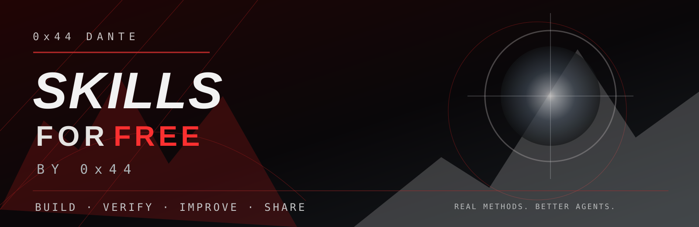
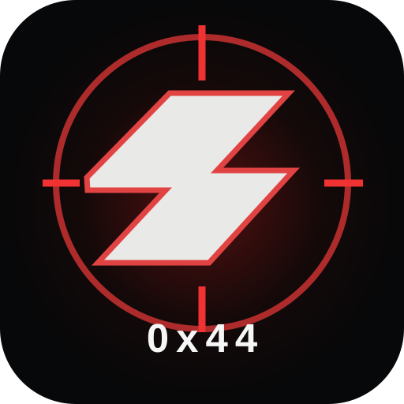

# Skills for Free by 0x44
**Practical research and verification skills for AI coding agents.**

[English](#english) · [Deutsch](#deutsch) · [License](LICENSE)

---

## English

**Same agents. Higher standards.**

This community project shares free, project-agnostic skills for AI coding assistants such as Claude Code and Codex. They focus on disciplined engineering: measured claims, negative controls, regression testing and traceable handovers.

### Free skill pack — English
| Skill | What it helps with |
| --- | --- |
| [Evidence Discipline](packs/en/evidence-discipline/SKILL.md) | Separate observations, explanations, hypotheses and conclusions. |
| [Change Validation](packs/en/change-validation/SKILL.md) | Make tests catch real defects, validate fixes and avoid destructive Git shortcuts. |
| [Numbers & Handover](packs/en/numbers-and-handover/SKILL.md) | Keep numerical claims traceable and project transitions reproducible. |

**Install:** Copy a desired skill folder into your coding assistant's supported skills directory, preserving its `SKILL.md`. Configure skill discovery according to the installed version of your tool. These are plain-language agent instructions; they are **not executable security tools** and have not been benchmarked here as a packaged product.

**Example request:** “Apply the evidence-discipline skill to this failure. Give the observation, suspected mechanism, falsifying counterexample and what remains unverified.”

### Boundaries
- The free edition contains generic, reusable methods, **not** the private ARGUS/ATLAS/NEMESIS source material or proprietary test fixtures.
- Do not claim a test passed unless it actually ran. Record negative and inconclusive results.
- Do not run destructive actions or security testing against external systems without explicit authorization and scope.
- The skills are guidance, not a guarantee that an AI agent will comply or that its output will be correct.
- Pull requests with concrete examples and counterexamples are welcome.

### License
MIT — see [LICENSE](LICENSE). This license permits commercial redistribution and modification, subject to its conditions. Separate future professional offerings are not included here.

---

## Deutsch

**Dieselben Agenten. Höhere Standards.**

Dieses Community-Projekt veröffentlicht kostenlose, projektunabhängige Skills für KI-Coding-Assistenten wie Claude Code und Codex. Im Mittelpunkt stehen wissenschaftlich saubere Entwicklungsabläufe: nachvollziehbare Messungen, Gegenproben, Regressionstests und reproduzierbare Übergaben.

### Kostenloses Skill-Paket — Deutsch
| Skill | Wofür er hilft |
| --- | --- |
| [Beweisdisziplin](packs/de/evidence-discipline/SKILL.md) | Beobachtungen, Ursachen, Hypothesen und Schlussfolgerungen sauber trennen. |
| [Änderungsverifikation](packs/de/change-validation/SKILL.md) | Aussagekräftige Tests entwickeln, Fixes prüfen und riskante Git-Abkürzungen vermeiden. |
| [Zahlen & Übergabe](packs/de/numbers-and-handover/SKILL.md) | Zahlen aus Primärdaten übernehmen und Projektstände nachvollziehbar übergeben. |

**Installation:** Den gewünschten Skill-Ordner in das von deinem Coding-Assistenten unterstützte Skill-Verzeichnis kopieren und `SKILL.md` beibehalten. Die automatische Erkennung hängt von der jeweiligen Version und Konfiguration ab. Diese Skills enthalten Anweisungen, **keine ausführbaren Sicherheitswerkzeuge**. Ein unabhängiger Paket-Benchmark wurde hier noch nicht durchgeführt.

**Beispielanfrage:** „Nutze den Skill Beweisdisziplin für diesen Fehler. Trenne Beobachtung, vermutete Ursache, widerlegende Gegenprobe und offene Unsicherheiten.“

### Grenzen
- Die Free-Version enthält allgemeine Methoden, **keine** privaten ARGUS-, ATLAS- oder NEMESIS-Quellen beziehungsweise proprietären Testfälle.
- Tests nur als bestanden melden, wenn sie tatsächlich ausgeführt wurden. Negative und unbestimmte Ergebnisse dokumentieren.
- Keine destruktiven Aktionen oder Sicherheitstests an fremden Systemen ohne ausdrückliche Autorisierung und Scope.
- Skills sind Arbeitsanweisungen und garantieren weder Agentengehorsam noch korrekte Ergebnisse.
- Konkrete Verbesserungen mit Gegenbeispielen sind als Pull Requests willkommen.

### Lizenz
MIT – siehe [LICENSE](LICENSE). Die Lizenz erlaubt unter ihren Bedingungen auch kommerzielle Weiterverwendung und Bearbeitung. Mögliche separate professionelle Angebote sind nicht Teil dieses Repositories.

---

